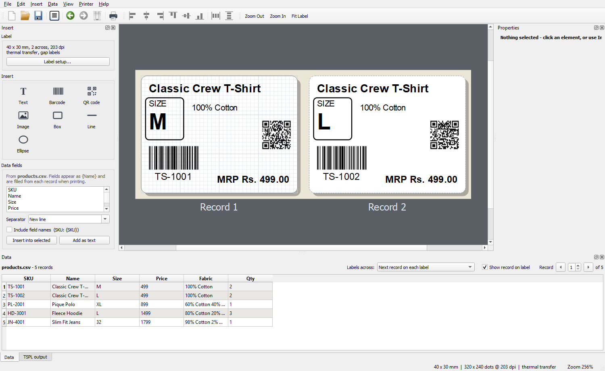
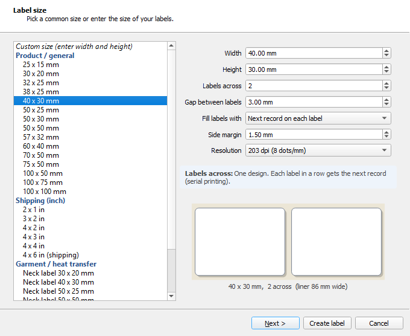
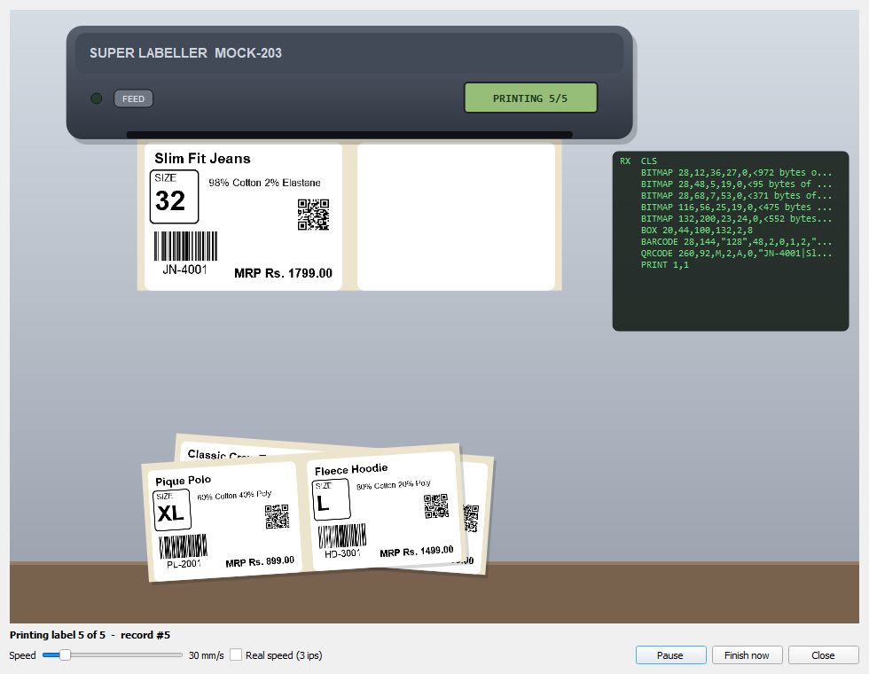

# Super Labeller

**Design thermal and heat-transfer labels and print them on TSPL / TSPL2 printers**
(TSC and compatible), one at a time or in batches from Excel, CSV or a database.



## Download

Get **`SuperLabeller.exe`** from the [latest release](https://github.com/kullu1991/SuperLabeller/releases/latest).
It is a single file: no installation and no Python needed (64-bit Windows 10 / 11). Double-click to start.

> Windows SmartScreen may say *"Windows protected your PC"* because the program is new and not
> code-signed. Click **More info → Run anyway**. Some antivirus tools also flag new PyInstaller
> programs; you can check the file on VirusTotal or build it yourself from source (below).

## Features

- **Setup wizard** for every new label: common sizes (product, shipping, garment neck / care labels)
  or your own, 203 / 300 / 600 dpi, gap / black-mark / continuous media, ribbon (thermal transfer) or
  direct thermal, mirror for heat-transfer film, speed, darkness, tear / peel / cutter.
- **Elements:** text in any Windows font and any language, printer fonts, barcodes (Code 128,
  GS1-128, Code 39 / 93, EAN-13 / 8, UPC-A / E, 2-of-5, ITF-14, Codabar, MSI), QR codes, boxes,
  lines, ellipses and images (logos and photos, with dithering).
- **Editing:** drag and snap to a grid, resize handles, undo / redo, copy / paste,
  **align & distribute**, z-order.
- **Data merge:** connect **Excel (.xlsx), CSV, SQLite or any ODBC database** (SQL Server, MySQL,
  PostgreSQL, Access…). Column names become fields such as `{Name}` and can be used in text,
  barcodes and QR codes. Several fields can be combined with a separator of your choice. Formats
  are supported: `{Price:.2f}`, `{Date:%d/%m/%Y}`, `{Serial:06d}`.
- **Batch printing:** all records, the current record, selected rows or a range. Copies can be
  fixed or taken from a quantity column.
- **2-up / 3-up media:** several labels across the roll. Fill them with the *next record*, the
  *same record*, or give **each label its own design**. Every label in the row shows a live
  preview of its real content.
- **Printing:** installed Windows printer (RAW), network (TCP 9100), serial / COM port, or a
  `.prn` file. You can also feed, calibrate (`GAPDETECT`) and run a self-test.
- **Mock printer:** no printer at hand? Watch the labels come out of an animated printer, with
  the real data.
- **Live TSPL output** panel: see exactly what is sent to the printer.

| Setup wizard | Mock printer |
|---|---|
|  |  |

## Quick start

1. Start Super Labeller. The **setup wizard** asks for the label size and printer settings.
2. Add elements from the **Insert** panel on the left and edit them under **Properties** on the right.
3. Optional: **Data → Data Source…** to connect an Excel / CSV file or a database, then double-click
   fields in the **Data fields** list to insert them.
4. **Print**. Choose your printer, or the *Mock printer* to try it out.

Try the example: open [`examples/garment-2up.tlabel`](examples/garment-2up.tlabel). It loads
`products.csv` from the same folder.

### Tips for heat-transfer labels

- Use **Thermal transfer (ribbon)**, which sends `SET RIBBON ON`.
- Film that is pressed face-down needs **Mirror image**.
- Film and resin ribbons usually need **darkness 10–15** and **speed 2–3 ips**.
- If images or text print inverted, untick **Bitmap: 0 bit = black** in *Label setup → Advanced*.
- If your printer rejects a command, tick **Send as one bitmap** (*Label setup → Advanced*).

## Placeholders

| Placeholder          | Result                                   |
|----------------------|------------------------------------------|
| `{Name}`             | column value                             |
| `{Price:.2f}`        | 2 decimals: `499.50`                     |
| `{Serial:06d}`       | zero padded: `000042`                    |
| `{MfgDate:%d/%m/%Y}` | date format (default `dd-mm-yyyy`)       |
| `{_row}` / `{_count}`| record number / number of records        |
| `{_date}` / `{_time}`| today's date / current time              |

Database access uses the database's ODBC driver, which must be installed in Windows
(e.g. *ODBC Driver 17/18 for SQL Server*, *MySQL Connector/ODBC*, *psqlODBC*).

## Run or build from source

Requires Python 3.9+.

```
pip install -r requirements.txt
python main.py
```

Build the single-file EXE (`dist/SuperLabeller.exe`):

```
pip install pyinstaller
python build.py
```

The GitHub Actions workflow in `.github/workflows/build.yml` builds the EXE on every push and
attaches it to a release when a version tag (`v*`) is pushed.

### Code layout

```
main.py                    entry point
build.py                   PyInstaller build (EXE with version info)
superlabeller/model.py     document model, label presets, property schemas
superlabeller/render.py    drawing of elements (screen preview and printer bitmaps)
superlabeller/tspl.py      TSPL command generation, multi-up rows, batches
superlabeller/canvas.py    design canvas
superlabeller/wizard.py    label setup wizard
superlabeller/insertpanel.py  left column: insert palette, data fields, icons
superlabeller/forms.py     property editor
superlabeller/datapanel.py data source dialog and records panel
superlabeller/datasource.py, merge.py  loading records, {Field} placeholders
superlabeller/printing.py  Windows / CUPS / network / serial / file output
superlabeller/mockprinter.py  the animated mock printer
superlabeller/mainwindow.py
tools/                     icon, example and screenshot generators
```

## License

Copyright © 2026 Kulbhushan Srivastava.

Super Labeller is free software under the **GNU General Public License v3.0**; see [LICENSE](LICENSE).
It is distributed in the hope that it will be useful, but WITHOUT ANY WARRANTY.
Third-party components and their licenses are listed in [THIRD_PARTY_NOTICES.md](THIRD_PARTY_NOTICES.md).

TSC and TSPL are trademarks of TSC Auto ID Technology Co., Ltd. This project is not affiliated
with or endorsed by TSC.
